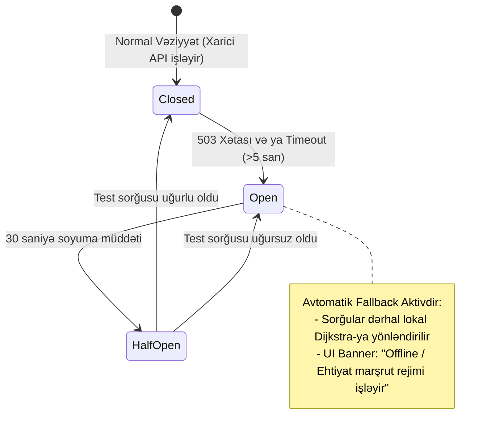
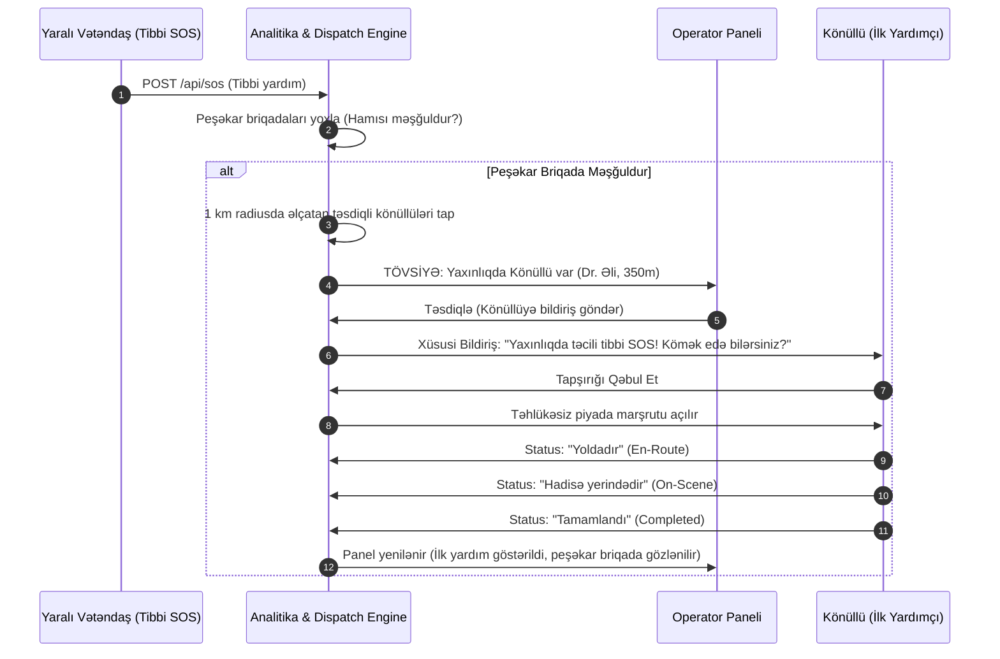

# Urban Crisis — Əlavə İnovasiyalar və Çevik Resurs İdarəetmə Planı (Müstəqil Əlavə Plan)

> **Məqsəd:** Mövcud Master Planı toxunulmaz saxlayaraq, yeni tələb olunan 4 strateji modulu ayrıca, müstəqil və asanlıqla inteqrasiya oluna bilən şəkildə həyata keçirmək.  
> **Əhatə olunan sahələr:**
> 1. 🛡️ Xarici API Çökməsi üçün **Circuit Breaker & Avtomatik Offline Fallback**
> 2. 🤝 **Çevik Könüllü və İlk Yardım İdarəetmə Sistemi (Crowdsourced First Responders)**
> 3. 📢 **Geo-Hədəfli Böhran Xəbərləri və Avtomatik Bildiriş Lenti (Crisis Broadcast)**
> 4. 📦 **Sığınacaqların Ehtiyat Resurslarının İzlənməsi (Shelter Resource Tracking: Su, Qida, Dərman, Batareya)**

---

## 1. 🛡️ Xarici Xəritə API Çökməsi: Circuit Breaker & Offline Fallback

### 1.1. Problem və Ssenari
- Vətəndaşın marşrut alması üçün istifadə olunan xarici xəritə/routing API-si (OSRM, GraphHopper və s.) `HTTP 503 Service Unavailable` xətası qaytarır və ya şəbəkə gecikməsi səbəbindən cavab müddəti 5 saniyəni aşır (`timeout > 5000ms`).
- **Tələb:** Sistem unhandled exception verməməli, qətiyyən çökməməli, Circuit Breaker dərhal açılmalı və lokal daxili qraf mühərrikinə (`local fallback engine`) keçərək istifadəçiyə kəsintisiz xidmət göstərməlidir.

### 1.2. Arxitektura: Circuit Breaker Vəziyyət Diaqramı



### 1.3. Texniki Həll (`lib/crisis/circuit-breaker.ts`)
```typescript
type CircuitState = "CLOSED" | "OPEN" | "HALF_OPEN";

class RoutingCircuitBreaker {
  private state: CircuitState = "CLOSED";
  private failureCount = 0;
  private readonly threshold = 1; // 1 xəta və ya timeout kifayətdir
  private lastFailureTime = 0;
  private readonly cooldown = 30000; // 30 san sonra yoxla

  async executeWithFallback<T>(
    externalCall: (signal: AbortSignal) => Promise<T>,
    fallbackCall: () => Promise<T> | T
  ): Promise<{ data: T; isFallback: boolean; reason?: string }> {
    const now = Date.now();

    // 1. Circuit Açıqdırsa, xarici API-yə getmə, birbaşa lokal fallback işlət
    if (this.state === "OPEN") {
      if (now - this.lastFailureTime > this.cooldown) {
        this.state = "HALF_OPEN";
      } else {
        return { data: await fallbackCall(), isFallback: true, reason: "Xarici marşrut xidməti müvəqqəti əlçatmazdır (Circuit Open)" };
      }
    }

    // 2. Xarici API-yə 5 saniyəlik timeout ilə sorğu göndər
    const controller = new AbortController();
    const timeoutId = setTimeout(() => controller.abort(), 5000);

    try {
      const res = await externalCall(controller.signal);
      clearTimeout(timeoutId);
      this.state = "CLOSED";
      this.failureCount = 0;
      return { data: res, isFallback: false };
    } catch (err: any) {
      clearTimeout(timeoutId);
      this.failureCount++;
      this.lastFailureTime = Date.now();
      this.state = "OPEN";

      const isTimeout = err.name === "AbortError";
      const reason = isTimeout 
        ? "Xarici xidmət 5 saniyə ərzində cavab vermədi (Timeout)" 
        : `Xarici xidmət xətası (${err.status || 503} Service Unavailable)`;

      // Lokal daxili alqoritmə problemsiz keçid
      const fallbackResult = await fallbackCall();
      return { data: fallbackResult, isFallback: true, reason };
    }
  }
}
```

### 1.4. UI Təsiri
- İstifadəçi interfeysində sarı rəngli sabit xəbərdarlıq paneli çıxır:
  > ⚠️ **Offline / Ehtiyat marşrut rejimi aktivdir.**  
  > *Xarici naviqasiya serveri əlçatmazdır (503/Timeout). Marşrut daxili təxliyə qrafı üzrə lokal hesablandı.*

---

## 2. 🤝 Çevik Resurs və Könüllü İdarəetməsi (Crowdsourced Volunteers)

### 2.1. Konsept və İş Mexanizmi
Fövqəladə halda peşəkar briqadalar başqa hadisələrdə məşğul olduqda, yaxınlıqdakı sertifikatlı ilk yardım bacarıqlı vətəndaşlar (həkimlər, tibb bacıları, təlim görmüş könüllülər) həyat qurtarıcı qüvvəyə çevrilir.
- **Əsas Qayda:** Könüllünün cəlb olunması **heç vaxt peşəkar yardımın göndərilməsini ləğv etmir və dayandırmır!** Könüllü peşəkarlar çatana qədər körpü rolunu oynayır.

### 2.2. Könüllü Data Modeli
```typescript
export type Volunteer = {
  id: string;
  citizenId: string;
  name: string;
  phone: string;
  skills: ("first_aid" | "paramedic" | "fire_response" | "rescue")[];
  verified: boolean; // İlk yardım təsdiqi
  available: boolean; // Əlçatanlıq statusu
  location: Point;
  activeTaskId?: string;
  status: "idle" | "assigned" | "en_route" | "on_scene" | "completed";
};

export type VolunteerTask = {
  id: string;
  sosId: string;
  volunteerId: string;
  status: "pending_acceptance" | "en_route" | "on_scene" | "completed";
  assignedAt: number;
  acceptedAt?: number;
  arrivedAt?: number;
  completedAt?: number;
};
```

### 2.3. Alqoritm: Könüllü Tövsiyəsi və İdarəetmə Prosesi


### 2.4. Dispetçer və Könüllü Panelləri
1. **Operator Görünüşü:**
   - Hadisə kartında xüsusi bölmə: `🤝 Könüllü Dəstəyi Təklifi: Samir Əliyev (İlk Yardımçı - 400m)`.
   - Düymə: `[ Könüllünü Səfərbər Et (1 Klik) ]`.
   - Canlı İzləmə: Könüllünün cari statusu (`Yoldadır` ➔ `Hadisə yerindədir` ➔ `Tamamlandı`).
2. **Könüllü Görünüşü (Vətəndaş modulu daxilində "Könüllü Rejimi"):**
   - Könüllü statusunu "Mən hazıram" vəziyyətinə keçirir.
   - Çağırış gəldikdə səsli bildirişlə təcili qəbul modalı açılır.
   - Qəbul edildikdə hadisə nöqtəsinə doğru ən yaxın maneəsiz marşrut cızılır.

---

## 3. 📢 Geo-Hədəfli Xəbərlər və Xəbərdarlıq Paneli (Crisis News & Alerts)

### 3.1. Konsept
Böhran zamanı dezinformasiyanın qarşısını almaq üçün təsdiqlənmiş SOS klasterləri və qərarlar əsasında sistem dərhal **avtomatlaşdırılmış rəsmi operativ xəbər** formalaşdırır və dərc edir.

### 3.2. Data Modeli
```typescript
export type CrisisNews = {
  id: string;
  createdAt: number;
  zone: string;
  headline: string;
  content: string;
  severity: "info" | "warning" | "danger";
  targetRadiusMeters: number;
  incidentType: string;
  author: "Sistem Analitika" | "Baş Dispetçer";
};
```

### 3.3. Avtomatik Xəbər Şablonlaşdırma Mühərriki
- **Tətikləyici:** Klaster alerti təsdiqləndikdə və ya yol bağlandıqda.
- **Nümunə Avtomatik Xəbər:**
  - *Başlıq:* `[Nəsimi Rayonu] Təcili Xəbərdarlıq: 28 May yaxınlığında qaz sızması/yanğın qeydə alınıb.`
  - *Mətn:* `Ərazidəki vətəndaşlara Nizami sığınacağına doğru hərəkət etmək tövsiyə olunur. Fəvvarələr küçəsi hərəkətə bağlanıb. Ərazidə olan tibb könüllülərindən Nəsimi qovşağına yaxınlaşmaları xahiş olunur.`
- **Hədəfli Çatdırılma:**
  - Həmin zonada (və ya 1 km radiusda) olan vətəndaşların ekranında dərhal xəbər pop-up bildirişi çıxır.
  - Qeydiyyatlı **könüllü həkimlərə** isə qırmızı prioritetli bildiriş gedir:  
    `🚨 [Həkim Çağırışı] Sizin zonada təcili yardıma ehtiyac var!`

---

## 4. 📦 Sığınacaqların Ehtiyat Resurslarının İzlənməsi (Resource Tracking)

### 4.1. Konsept və Əhəmiyyəti
Sığınacaq təkcə fiziki sahə deyil; orada olan insanların həyatda qalması üçün **Su, Qida, Tibbi Dəst və Enerji/Batareya** ehtiyatları vacibdir.
- Əgər bir məntəqə 90% dolarsa VƏ YA su ehtiyatı kritik həddə (20%-dən aşağı) düşərsə, sistem yeni insanları bu məntəqəyə yönləndirməyi dayandırır, digər **bol resurslu sığınacaqlara** yönəldir və dispetçerə təchizat bildirişi göndərir.

### 4.2. Data Modeli
```typescript
export type ShelterResources = {
  waterLiters: number;
  waterMax: number;
  foodRations: number;
  foodMax: number;
  medicalKits: number;
  batteryPercent: number; // Generator / batareya təminatı
  lastSuppliedAt: number;
};

// Shelter tipinə resurs sahəsi əlavə olunur:
export type ShelterWithResources = Shelter & {
  resources: ShelterResources;
};
```

### 4.3. Resurs-Əsaslı Ağıllı Yönləndirmə Alqoritmi
```typescript
export function isShelterEligible(shelter: ShelterWithResources, rules: Config): boolean {
  const occPercent = (shelter.occupied / shelter.capacity) * 100;
  const waterPercent = (shelter.resources.waterLiters / shelter.resources.waterMax) * 100;
  const foodPercent = (shelter.resources.foodRations / shelter.resources.foodMax) * 100;

  // 1. Fiziki doluluq həddi (90%)
  if (occPercent >= rules.routeLimit) return false;

  // 2. Kritik resurs tükənməsi (Su < 15% və ya Qida < 10%)
  if (waterPercent < 15 || foodPercent < 10) {
    return false; // İnsan göndərməyi dayandır!
  }

  return shelter.open;
}
```

### 4.4. Dispetçer Panelində Resurs Xəbərdarlığı və Təchizat Sifarişi
1. **Resurs İndikatorları:** Hər sığınacağın kartında 4 mini progress bar:
   - 💧 Su: `1200 / 5000 L (24%)`
   - 🍞 Qida: `300 / 2000 pors (15%)`
   - 🩹 Tibbi Dəst: `45 ədəd`
   - 🔋 Enerji: `85%`
2. **Kritik Çatışmazlıq Bildirişi:** Su və ya qida azaldıqda narıncı xəbərdarlıq:
   - `⚠️ Mərkəzi Park Sığınacağı: Su ehtiyatı kritik həddədir (<20%). Yeni təxliyələr alternativ Ehtiyat-2 məntəqəsinə yönləndirildi.`
3. **1-Klik Təchizat Düyməsi:**  
   - `[ 🚚 Təchizat Karvanı Göndər ]` ➔ Məntəqənin resurslarını avtomatik 100%-ə bərpa edir və auditə yazır.

---

## 5. 🛠️ Əlavə Modulların Fayl Strukturu və İcra Xəritəsi

```
Urban_Crisis_Prototype/
├── lib/crisis/
│   ├── circuit-breaker.ts       🆕 Xarici API üçün Circuit Breaker & Timeout mexanizmi
│   ├── volunteers.ts            🆕 Könüllülərin qeydiyyatı, məsafə analizi və tapşırıq idarəsi
│   ├── resources.ts             🆕 Sığınacaq resurslarının hesablanması və tükənmə xəbərdarlığı
│   ├── news.ts                  🆕 Geo-hədəfli xəbər generasiyası və filtrasiyası
│   └── commands.ts              ✏️ volunteer-dispatch, resource-resupply, checkin əməliyyatları
├── app/
│   ├── ui-news.tsx              🆕 Vətəndaş və Operator üçün Xəbərlər Lenti komponenti
│   ├── ui-volunteers.tsx        🆕 Könüllü idarəetmə və qeydiyyat modulu
│   └── ui.tsx                   ✏️ Circuit Breaker banneri, resurs barları və könüllü statusları
└── tests/
    └── expansion.test.cjs       🆕 Circuit breaker, könüllü axını və resurs yönləndirmə testləri
```

---

## 6. 🚀 Addım-Addım İcra və Test Ardıcıllığı

1. **Addım 1 (Circuit Breaker):** `lib/crisis/circuit-breaker.ts` yaradılır. 5 saniyəlik timeout və 503 xətası simulyasiya edilərək avtomatik lokal Dijkstra-ya problemsiz keçid test edilir.
2. **Addım 2 (Resurs İzləmə):** Sığınacaqlara su/qida/batareya sahələri əlavə olunur. Su azaldıqda marşrutun avtomatik digər bol məntəqəyə yönlənməsi təmin edilir.
3. **Addım 3 (Könüllülər):** Könüllü modeli və status axını (`Yoldadır` ➔ `Hadisə yerindədir` ➔ `Tamamlandı`) qurulur. Peşəkar briqada olmadan ilk yardım təklifi nümayiş etdirilir.
4. **Addım 4 (Xəbərlər Paneli):** Klaster hadisələrindən avtomatik xəbər generatoru və geo-filtr inteqrasiya olunur.

Bu əlavə plan əsas sistemi dəyişmədən layihəni **innovasiya, dayanıqlılıq (resilience) və real həyat tətbiqi** baxımından hakatonun ən yüksək pilləsinə çıxarır!
