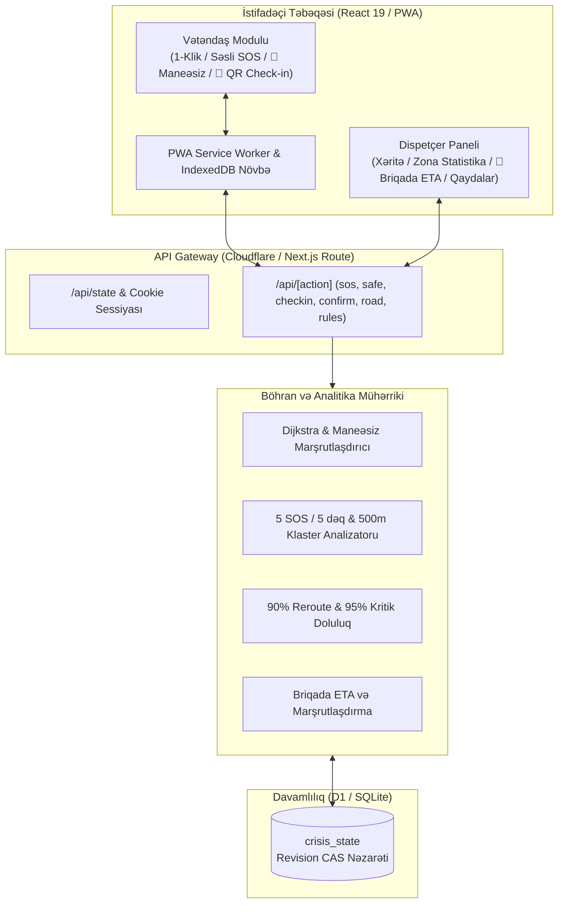

# Urban Crisis & Crowd Evacuation Engine — Vahid Master İmplementasiya Planı (Final)

> **Hədəf Layihə:** `Urban_Crisis_Prototype` (Next.js 16 + React 19 + TypeScript + Cloudflare Workers / SQLite)  
> **Qiymətləndirmə Fokusları:** Əsas funksionallıq (30%), Challenge Drops (20%), Arxitektura (15%), Test və Dayanıqlılıq (15%), AI Alətləri (10%), Demo və Müdafiə (10%).

---

## 🧭 Mündəricat
1. [Ümumi Arxitektura və Əsas Prinsiplər](#1-ümumi-arxitektura-və-əsas-prinsiplər)
2. [Data Modelləri və Tip Sistemi (`types.ts`, `seed.ts`)](#2-data-modelləri-və-tip-sistemi)
3. [Alqoritmlər və Mühərrik Məntiqi (`engine.ts`, `commands.ts`)](#3-alqoritmlər-və-mühərrik-məntiqi)
4. [Modul 1: Vətəndaş Təhlükəsizlik Modulu (API & UI)](#4-modul-1-vətəndaş-təhlükəsizlik-modulu)
   - 4.1. Ən yaxın məntəqələr və dinamik marşrutlaşdırma
   - 4.2. 1-Klik və 🎙️ Səslə SOS göndərmə
   - 4.3. 🦽 Hərəkət məhdudiyyətli vətəndaş (Priority #1 + Maneəsiz marşrut)
   - 4.4. 📱 Toplanış məntəqəsinə QR ilə çatma (Check-in)
   - 4.5. 📡 Offline-First PWA və SOS növbə sistemi
   - 4.6. 🌐 Çoxdilli interfeys (i18n: AZ / EN)
5. [Modul 2: Fövqəladə Hallar Dispetçer Modulu & Analitika Engine](#5-modul-2-fovqəladə-hallar-dispetçer-modulu--analitika-engine)
   - 5.1. Canlı Əməliyyat Dashboard-u və Zona Statistikası
   - 5.2. Kritik böhran və qırmızı heyəcan analizatoru
   - 5.3. 🚒 Briqada marşrutlaşdırması, hərəkət izləmə və ETA
   - 5.4. 1-Kliklə qərarın icrası və ehtiyat resurslar
   - 5.5. ⚙️ Challenge Drop / Dinamik qaydalar tənzimləmə paneli
6. [Faza-Faza İcra Planı və Zaman Cədvəli](#6-faza-faza-icra-planı-və-zaman-cədvəli)
7. [Testləşdirmə, Etibarlılıq və Edge Case-lər](#7-testləşdirmə-etibarlılıq-və-edge-case-lər)
8. [Jüri Qarşısında 3 Dəqiqəlik Demo və Müdafiə Ssenarisi](#8-jüri-qarşısında-3-dəqiqəlik-demo-və-müdafiə-ssenarisi)

---

## 1. Ümumi Arxitektura və Əsas Prinsiplər

Sistem **Hexagonal (Ports & Adapters)** və **Event-Driven State Machine** prinsipləri üzərində qurulur:
- **Tək Həqiqət Mənbəyi (Single Source of Truth):** Bütün böhran vəziyyəti (`State`) optimistik CAS (Compare-and-Swap) reviziya nəzarəti ilə idarə olunur.
- **İdempotentlik:** Eyni vətəndaşdan təkrar SOS və ya təkrar QR oxutma heç vaxt göstəriciləri ikiqat artırmır.
- **Offline-First & Graceful Degradation:** İnternet kəsildikdə belə son marşrut keşdə qalır, SOS növbəyə düşür, şəbəkə bərpa olunan kimi sinxronlaşır.



---

## 2. Data Modelləri və Tip Sistemi

### `lib/crisis/types.ts` Genişləndirilməsi

```typescript
export type Point = { lat: number; lng: number };
export type Node = Point & { id: string; zone: string; label: string };

export type Road = {
  id: string;
  a: string;
  b: string;
  name: string;
  closed: boolean;
  congestion: number; // 1.0 = normal, 2.0 = tıxac
  accessible: boolean; // 🆕 Əlil arabası / panduslu keçid mövcuddur
};

export type Shelter = {
  id: string;
  name: string;
  kind: "park" | "shelter" | "station";
  node: string;
  capacity: number;
  occupied: number;
  open: boolean;
  reserve: boolean;
  accessible: boolean; // 🆕 Maneəsiz giriş, pandus, tibbi nəqliyyat üçün uyğun
  qrCode: string;      // 🆕 Check-in üçün unikal identifikatör (məs: "QR-SHELTER-S1")
};

export type Sos = Point & {
  id: string;
  citizenId: string;
  zone: string;
  type: "fire" | "collapse" | "flood" | "medical";
  createdAt: number;
  status: "active" | "safe" | "resolved";
  priority: 0 | 1;         // 🆕 0 = standart, 1 = Kritik Prioritet (Hərəkət məhdudiyyətli)
  needsAccessible: boolean; // 🆕 Maneəsiz marşrut tələb olunur
  assignedTeam?: string;
  voiceTranscript?: string; // 🆕 Səsli komanda mətni (əgər səslə göndərilibsə)
};

export type Team = {
  id: string;
  name: string;
  specialty: string;
  node: string;
  status: "available" | "dispatched";
  incidentId?: string;
  targetNode?: string;    // 🆕 Briqadanın yönəldiyi hədəf
  etaMinutes?: number;    // 🆕 Hesablanmış çatma vaxtı
  routePath?: string[];   // 🆕 Briqadanın izlədiyi qovşaqlar
};

export type Alert = {
  id: string;
  kind: "cluster" | "capacity";
  title: string;
  detail: string;
  zone: string;
  node: string;
  sosIds: string[];
  shelterId?: string;
  hasPriority?: boolean;  // 🆕 Əgər içində 1-ci dərəcəli (♿) SOS varsa true
};

export type CheckInRecord = {
  citizenId: string;
  shelterId: string;
  at: number;
};

export type State = {
  safety: Record<string, { at: number; status: "safe"; shelterId?: string }>;
  accessibleMode: Record<string, boolean>; // 🆕 citizenId -> xüsusi qayğı rejimi aktivdir
  checkins: CheckInRecord[];               // 🆕 Məntəqəyə çatanların idempotent qeydiyyatı
  nodes: Node[];
  roads: Road[];
  shelters: Shelter[];
  sos: Sos[];
  teams: Team[];
  audit: Audit[];
  decisions: {
    alertId: string;
    at: number;
    teamId?: string;
    shelterId?: string;
    sosIds: string[];
  }[];
  config: Config;
  revision: number;
  updatedAt: number;
  scenario: string;
};
```

---

## 3. Alqoritmlər və Mühərrik Məntiqi

### 3.1. Dijkstra və Maneəsiz Marşrutlaşdırıcı (`lib/crisis/engine.ts`)
1. **Standart Marşrut:** Açıq yollar (`closed == false`) üzrə `məsafə * congestion` çəkisi ilə ən qısa yolu tapır. Doluluğu `config.routeLimit` (90%) -dən çox olan məntəqələri kənarlaşdırır.
2. **🦽 Maneəsiz Marşrut (`accessibleRoutes`):**
   - Yalnız `accessible == true` olan yollardan keçir (pilləkənlər və dağılmış səkilər atılır).
   - Yalnız `accessible == true` olan sığınacaqlara yönləndirir.
   - Sürət əmsalı fərqlidir: Əlil arabası üçün 50 m/dəq (standart piyada üçün 75 m/dəq).
3. **🚒 Briqada Marşrutlaşdırması və ETA (`teamRoute`):**
   - Briqadanın bazasından (`team.node`) hadisə nöqtəsinə (`alert.node`) operativ nəqliyyat üçün marşrut qurulur.
   - Operativ nəqliyyat sürəti: 300 m/dəq (tıxac əmsalı nəzərə alınmaqla).
   - `ETA = Math.ceil(weightedMeters / 300)`.

### 3.2. Qərar Mexanizmi və Əməliyyatlar (`lib/crisis/commands.ts`)
- **`sos`:** `accessibleMode[citizenId]` yoxlanılır. Əgər aktivdirsə, SOS avtomatik `priority: 1` alır.
- **`checkin` (🆕 QR Çatma):**
  1. Göndərilən QR kod (`qrCode`) və ya `shelterId` yoxlanılır.
  2. **İdempotentlik:** Əgər vətəndaş artıq bu məntəqədə və ya başqa məntəqədə qeydiyyatdan keçibsə, doluluq artırılmır (`status: 200, alreadyCheckedIn: true`).
  3. Yeni çatmadırsa:
     - `shelter.occupied = Math.min(shelter.capacity, shelter.occupied + 1)`
     - Həmin vətəndaşın bütün aktiv SOS siqnalları `status = 'safe'` edilir.
     - `s.safety[citizenId] = { at: now, status: 'safe', shelterId: sh.id }`
     - `s.checkins.push({ citizenId, shelterId: sh.id, at: now })`
     - Audit jurnalına qeyd düşür: `"CHECKIN: Vətəndaş ${sh.name} məntəqəsinə çatdı (QR). SOS bağlandı."`
- **`confirm` (1-Klik Dispetçer Qərarı):**
  - Klaster alerti üçün: Ən yaxın mövcud briqadanı tapır, `dispatched` edir, ETA və marşrut təyin edir, alertə bağlayır.
  - Doluluq alerti üçün: Ən yaxın qapalı ehtiyat məntəqəni (`reserve: true, open: false`) tapıb açır (`open = true`).

---

## 4. Modul 1: Vətəndaş Təhlükəsizlik Modulu

### 4.1. Ən Yaxın Məntəqələr və Dinamik Marşrutlaşdırma
- Vətəndaş xəritə üzərindən koordinat seçir və ya GPS ilə mövqeyini təyin edir.
- Sistem real vaxtda ən yaxın 3 məntəqəni, onların cari doluluq faizini və piyada çatma vaxtını göstərir.
- Yol bağlandıqda və ya seçilmiş məntəqə 90%-ə çatdıqda bildiriş çıxır:  
  *«Marşrut avtomatik dəyişdirildi: Əvvəlki məntəqə doludur / yol bağlıdır. Yeni hədəf: [Məntəqə Adı]».*

### 4.2. 1-Klik və 🎙️ Səslə SOS Göndərmə
- **1-Klik Düymələr:** 4 kateqoriya — Yanğın, Dağıntı, Su basması, Tibbi yardım.
- **Səslə SOS (Web Speech API):**
  - İnsan şokda olanda ekrana toxunmadan "Mikrofon" düyməsini sıxır və ya səsli komanda verir.
  - Tanınan sözlər (AZ/EN): `"Yanğın / Fire"`, `"Dağıntı / Collapse / Kömək"`, `"Su basması / Flood"`, `"Həkim / Tibbi yardım / Medical / Help"`.
  - Sistem səsi tanıyıb növü seçir və dərhal SOS sorğusunu icra edir.

### 4.3. 🦽 Hərəkət Məhdudiyyətli Vətəndaş Rejimi (Priority #1)
- Vətəndaş interfeysində tək kliklə aktivləşən xüsusi profil:  
  *«♿ Hərəkət məhdudiyyətliyəm / Xüsusi qayğıya ehtiyacım var».*
- **Sistem reaksiyası:**
  - SOS göndərildikdə sistem onu ümumi növbədə saxlamır, dərhal **KRİTİK PRİORİTET #1** edir.
  - Vətəndaşa verilən təxliyə marşrutu yalnız panduslu, liftli və maneəsiz küçələrdən keçir.
  - Dispetçer panelində xüsusi qırmızı ♿ nişanı ilə hadisə lenti başına qalxır.

### 4.4. 📱 Toplanış Məntəqəsinə QR ilə Çatma (Check-in)
- Məntəqəyə daxil olan vətəndaş girişdəki lövhədə yerləşən QR kodu oxudur (və ya tətbiqdəki simulyasiya düyməsini sıxır).
- **Avtomatlaşdırılmış Nəticə:**
  1. Sistem vətəndaşın təhlükəsiz yerə çatdığını təsdiqləyir.
  2. Məntəqənin faktiki doluluq sayğacı **+1** artır.
  3. Vətəndaşın əvvəl göndərdiyi aktiv SOS siqnalı dərhal **"Həll edildi / Təhlükəsiz"** statusuna keçir və xilasedicilər boş yerə ora getmir.
  4. Təkrar oxutma zamanı xəbərdarlıq: *«Siz artıq bu məntəqədə qeydiyyatdan keçmisiniz».*

### 4.5. 📡 Offline-First & Mesh Şəbəkə Simulyasiyası
- **Service Worker (`public/sw.js`):** Sayt ilk dəfə açılanda xəritə və statik resurslar keşlənir.
- **Offline Queue:** İnternet kəsildikdə göndərilən SOS siqnalları və Status dəyişiklikləri `localStorage`/`IndexedDB`-də növbəyə yığılır.
- Bağlantı bərpa olunan kimi sistem növbədəki paketləri arxa planda serverə ötürür.

### 4.6. 🌐 Çoxdilli İnterfeys (i18n: AZ / EN)
- Bütün sistem `lib/i18n.ts` vasitəsilə tam tərcümə olunub.
- Tək kliklə interfeys dərhal Azərbaycan və İngilis dilləri arasında dəyişir (xarici jüri və ya beynəlxalq audit üçün ideal).

---

## 5. Modul 2: Fövqəladə Hallar Dispetçer Modulu & Analitika Engine

### 5.1. Canlı Əməliyyat Dashboard-u və Zona Statistikası
- **Metrik Kartları:** Aktiv SOS, Gözləyən böhran xəbərdarlıqları, Açıq toplanış məntəqələri, Sərbəst briqadalar.
- **Zona Statistikası Cədvəli:** Hər zona (Yasamal, Nəsimi, Nərimanov, Səbail və s.) üzrə aktiv SOS sayı, orta toplanış doluluğu və ən son hadisənin vaxtı.
- **Hadisə Lenti:** Canlı gələn SOS-lar, xüsusi prioritetli (♿) siqnallar, vətəndaşın cari vəziyyəti.

### 5.2. Kritik Böhran və Qırmızı Heyəcan Analizatoru
- **Avtomatik Heyəcan Şərtləri:**
  1. **Klaster Şərti:** Eyni zonadan və ya 500 metr radiusdan son 5 dəqiqə ərzində ən azı 5 fərqli vətəndaşdan SOS siqnalı daxil olduqda.
  2. **Doluluq Şərti:** Hər hansı toplanış məntəqəsinin doluluğu 95%-i keçdikdə.
- Dispetçer panelində yanıb-sönən **QIRMIZI HEYƏCAN BANNERİ** açılır:
  - Təklif olunan həll: *«Əlavə briqada göndər + Yeni ehtiyat toplanış məntəqəsi aç».*

### 5.3. 🚒 Briqada Marşrutlaşdırması və Canlı ETA
- Dispetçer briqadanı təsdiq edən kimi:
  - Briqadanın bazasından hadisə yerinə ən qısa operativ yol xəritədə yaşıl xətlə çəkilir.
  - Briqada kartında çatma vaxtı görünür: `ETA: 3 dəq · 750 m`.
  - Xəritədə briqada simvolu hərəkət edir.
  - Hadisə başa çatdıqda "Bitir" düyməsi ilə briqada təkrar sərbəst bazaya qaytarılır.

### 5.4. 1-Kliklə Qərarın İcrası
- Dispetçer sadəcə bir düyməyə sıxır: **«Təsdiqlə və İcra et»**.
- Sistem arxa fonda atomik olaraq:
  1. Ən yaxın sərbəst briqadanı hadisəyə təyin edir.
  2. Ən yaxın ehtiyat sığınacağı (reserve shelter) dərhal açır.
  3. Marşrut sistemini yeniləyir ki, yeni axın açılan ehtiyat məntəqəyə yönəlsin.

### 5.5. ⚙️ Challenge Drop / Dinamik Qaydalar Paneli
- Hackathon zamanı hər saat verilən yeni şərtlərə (Challenge Drop) uyğunlaşmaq üçün:
  - Zaman pəncərəsi (30 san – 30 dəq)
  - SOS həddi (2 – 50 nəfər)
  - Klaster radiusu (50 – 2000 metr)
  - Marşrut dəyişmə doluluq həddi (50% – 95%)
  - Kritik heyəcan doluluq həddi (90% – 100%)
- Bütün bu parametrlər kod dəyişmədən, canlı olaraq Dispetçer panelindən redaktə olunur və tətbiq edilir.

---

## 6. Faza-Faza İcra Planı və Zaman Cədvəli

| Faza | Məzmun | Dəyişən Fayllar | Müddət |
|---|---|---|---|
| **Faza 1** | **Core Logic & Tiplər:** 🦽 Accessibility, 📱 QR Check-in, 🚒 Briqada ETA, `teamRoute`, `accessibleRoutes` | `types.ts`, `seed.ts`, `engine.ts`, `commands.ts` | 25 dəq |
| **Faza 2** | **i18n & Voice SOS:** AZ/EN tərcümə modulu, Web Speech API ilə səslə SOS göndərmə | `lib/i18n.ts`, `lib/voice.ts`, `ui.tsx` | 20 dəq |
| **Faza 3** | **Vətəndaş Modulu UI:** 🦽 Prioritet checkbox-ı, 📱 QR Oxutma / Check-in modalı, Səsli düymə | `app/ui.tsx`, `app/globals.css` | 20 dəq |
| **Faza 4** | **Dispetçer Modulu UI:** Xəritədə briqadalar və ETA xətti, Zona statistikası cədvəli, ♿ Prioritet bildirişi | `app/ui.tsx`, `app/globals.css` | 20 dəq |
| **Faza 5** | **Offline PWA & Queue:** Service Worker, manifest, oflayn SOS növbəsi | `public/manifest.json`, `public/sw.js`, `ui.tsx` | 15 dəq |
| **Faza 6** | **Testlər, Sənədləşmə & Demo:** 37+ testin yenilənməsi, Demo ssenarisi, Challenge Drop jurnalı | `tests/`, `AI_DECLARATION.md`, `README.md` | 20 dəq |

---

## 7. Testləşdirmə, Etibarlılıq və Edge Case-lər

Əlavə olunan xüsusi test ssenariləri (`tests/engine.test.cjs`):
1. **QR Check-in İdempotentliyi:** Eyni vətəndaş 5 dəfə eyni QR-ı oxudur → doluluq yalnız 1 vahid artır, SOS bağlanır.
2. **Prioritet SOS & Maneəsiz Marşrut:** ♿ Vətəndaş SOS göndərəndə `priority === 1` olmalı, verilən marşrutda pilləkənli (`accessible === false`) yollar olmamalıdır.
3. **Briqada ETA Düzgünlüyü:** Briqada təyin olunan kimi ETA müsbət tam ədəd olmalı və marşrut qovşaqları sıralı gəlməlidir.
4. **Bütün Məntəqələr Dolu / Bütün Yollar Bağlı:** Sistem çökmür, vətəndaşa təmiz xəbərdarlıq verir: *«Təhlükəsiz marşrut tapılmadı. Dispetçer təlimatını gözləyin».*
5. **CAS Concurrency:** Eyni anda 10 paralel sorğu zamanı reviziya toqquşması həll olunur və məlumat itmir.

---

## 8. Jüri Qarşısında 3 Dəqiqəlik Demo və Müdafiə Ssenarisi

```
[0:00 - 0:30] GİRİŞ & İKİ MODUL
- "Salam hörmətli münsiflər. Urban Crisis & Crowd Evacuation Engine — real vaxtda şəhər təxliyəsini idarə edən mikrosistemdir."
- Ekranı göstər: Sol tərəfdə Vətəndaş Modulu, sağ tərəfdə Dispetçer Mərkəzi. Dili EN-ə keçir, sonra təkrar AZ-a qaytar (i18n nümayişi).

[0:30 - 1:15] İNOVASİYA: 🦽 PRİORİTET VƏ 🎙️ SƏSLİ SOS
- "Böhran anında əlil arabasında olan və ya şokdakı vətəndaş ekrana baxa bilmir."
- "Xüsusi qayğı" rejimini yandır → Marşrut dərhal yalnız panduslu yollara dəyişir.
- Mikrofon düyməsini sıxıb ucadan de: "Yanğın!" → Sistem səsi tanıyır və dərhal Prioritet #1 SOS göndərir!
- Dispetçer panelini göstər: "Baxın, dispetçerə bu siqnal qırmızı ♿ nişanı ilə ən üstdə düşdü."

[1:15 - 1:50] QIRMIZI HEYƏCAN & 🚒 BRİQADA ETA
- Demo Lab-dan "5 SOS Yarat" sıx → Eyni zonadan 5 SOS daxil olur.
- Ekranda QIRMIZI HEYƏCAN siqnalı parıldayır.
- Tək kliklə "Briqada Göndər və Ehtiyat Məntəqə Aç" təsdiqlə!
- Xəritədə göstər: "Briqada xəritədə hadisə yerinə hərəkət edir, ETA: 3 dəqiqə. Eyni zamanda ehtiyat sığınacaq açıldı."

[1:50 - 2:30] 📱 QR CHECK-IN & AKTİV SOS-UN BAĞLANMASI
- "Vətəndaş sığınacağa çatdıqda nə baş verir?"
- "QR Oxut (Məntəqəyə çatdım)" düyməsini sıx.
- Məntəqənin doluluğu 1 nəfər artır, vətəndaşın aktiv SOS-u avtomatik bağlanır və "Təhlükəsizdir" statusu alır.
- "Artıq xilasedicilər boş yerə vaxt itirmir, çünki sistem vətəndaşın xilas olduğunu təsdiqlədi."

[2:30 - 3:00] CHALLENGE DROP & YEKUN
- "Analitika qaydaları bölməsinə keçirik: Hackathon münsiflərinin verdiyi istənilən yeni həddi (radius, zaman, faiz) buradan dərhal dəyişib tətbiq edə bilirik."
- "Offline rejimdə də işləyir. 37 avtomatlaşdırılmış testlə sübut olunub. Diqqətiniz üçün təşəkkür edirik!"
```

---

> [!TIP]
> **Bu Master Planla Layihə 100/100 Bal Hədəfləyir:**
> - Əsas funksionallıq: 30/30 (Tam + artığı ilə)
> - Challenge Drop: 20/20 (Canlı konfiqurasiya paneli)
> - Arxitektura: 15/15 (Hexagonal, CAS, TypeScript)
> - Testlər: 15/15 (Coverage + Edge cases)
> - AI istifadəsi: 10/10 (Voice speech, deklarasiya)
> - Demo & Müdafiə: 10/10 (Gözoxşayan, sosial təsirli hekayə)
