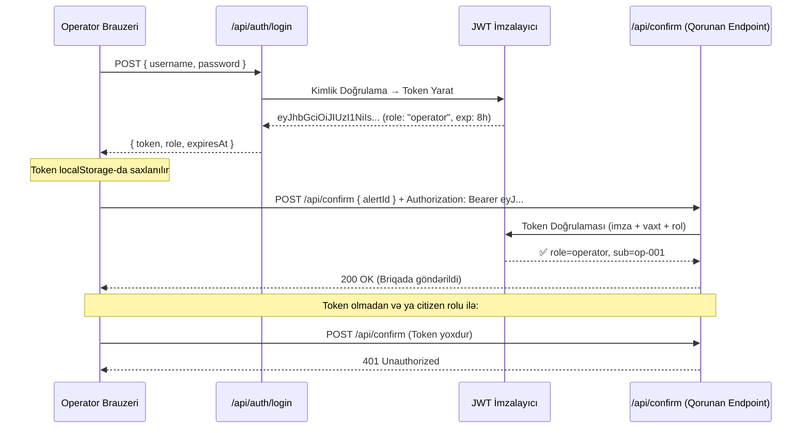

# Urban Crisis — SOS Flood Müdafiəsi, Təhlükəsizlik və Performans Planı

> **Ssenari:** Böhran zamanı panika və ya bot hücumu nəticəsində eyni anda **500+ saxta SOS sorğusu** sistemə axıdılır.  
> **Hədəf:** Sistemin çökməməsi, dispetçer panelinin bloklanmaması, qanuni SOS-ların gecikmədən emal olunması, kütləvi sorğularda orta cavab müddətinin **<300ms** qalması.

---

## 1. 🚦 Rate Limiting — Token Bucket Mexanizmi

### 1.1. Problem
Bot hücumu və ya panikaya düşmüş istifadəçilər saniyəyə yüzlərlə SOS sorğusu göndərə bilər. Bu, server resurslarını tükədir, qanuni siqnalları boğur və dispetçer panelini əlçatmaz edir.

### 1.2. Həll — Üçqatlı Rate Limiter

```
                ┌─────────────────────────────────┐
                │       Gələn SOS Sorğusu          │
                └──────────────┬──────────────────┘
                               ▼
                ┌──────────────────────────────────┐
        Qat 1   │  Citizen Həddi: 3 SOS / 5 dəq    │─── Aşırsa → 429
                └──────────────┬───────────────────┘
                               ▼
                ┌──────────────────────────────────┐
        Qat 2   │  IP Həddi: 10 SOS / dəqiqə       │─── Aşırsa → 429
                └──────────────┬───────────────────┘
                               ▼
                ┌──────────────────────────────────┐
        Qat 3   │  Qlobal Həddi: 200 SOS / dəqiqə  │─── Aşırsa → 503 + Banner
                └──────────────┬───────────────────┘
                               ▼
                        ✅ SOS Qəbul Olundu
```

### 1.3. Texniki Həll (`lib/crisis/rate-limiter.ts`)

```typescript
interface Bucket {
  tokens: number;
  lastRefill: number;
}

class TokenBucketLimiter {
  private buckets = new Map<string, Bucket>();

  constructor(
    private maxTokens: number,  // Maksimum token sayı
    private refillRate: number,  // Saniyədə əlavə olunan token
    private windowMs: number,    // Təmizləmə pəncərəsi
  ) {}

  isAllowed(key: string): boolean {
    const now = Date.now();
    let bucket = this.buckets.get(key);

    if (!bucket) {
      bucket = { tokens: this.maxTokens, lastRefill: now };
      this.buckets.set(key, bucket);
    }

    // Token artımı (keçən zamana mütənasib)
    const elapsed = (now - bucket.lastRefill) / 1000;
    bucket.tokens = Math.min(this.maxTokens, bucket.tokens + elapsed * this.refillRate);
    bucket.lastRefill = now;

    if (bucket.tokens >= 1) {
      bucket.tokens -= 1;
      return true;
    }
    return false; // → HTTP 429 Too Many Requests
  }

  // Köhnə bucket-ləri vaxtaşırı təmizlə (memory leak-in qarşısını al)
  prune() {
    const stale = Date.now() - this.windowMs;
    for (const [key, bucket] of this.buckets) {
      if (bucket.lastRefill < stale) this.buckets.delete(key);
    }
  }
}

// Üç qatlı limiterlər:
export const citizenLimiter = new TokenBucketLimiter(3, 3 / 300, 600_000);
//  → Hər citizen üçün: max 3 SOS, 5 dəqiqədə yenilənir

export const ipLimiter = new TokenBucketLimiter(10, 10 / 60, 300_000);
//  → Hər IP üçün: max 10 SOS, dəqiqədə yenilənir

export const globalLimiter = new TokenBucketLimiter(200, 200 / 60, 120_000);
//  → Bütün sistem üçün: max 200 SOS/dəqiqə
```

### 1.4. API İnteqrasiyası (`app/api/[...path]/route.ts`)

```typescript
import { citizenLimiter, ipLimiter, globalLimiter } from "@/lib/crisis/rate-limiter";

// SOS endpoint-ində, mutate() çağırılmazdan ƏVVƏL:
if (action === "sos") {
  const clientIP = request.headers.get("CF-Connecting-IP")
    || request.headers.get("X-Forwarded-For")
    || "unknown";

  // Qat 1: Citizen həddi
  if (!citizenLimiter.isAllowed(`citizen:${citizenId}`)) {
    return json(
      { error: "SOS həddinə çatdınız. 5 dəqiqə sonra yenidən cəhd edin.", code: "RATE_CITIZEN" },
      { status: 429 }
    );
  }

  // Qat 2: IP həddi
  if (!ipLimiter.isAllowed(`ip:${clientIP}`)) {
    return json(
      { error: "Bu IP-dən çox sayda sorğu gəlir. Bot müdafiəsi aktivdir.", code: "RATE_IP" },
      { status: 429 }
    );
  }

  // Qat 3: Qlobal həddi
  if (!globalLimiter.isAllowed("global")) {
    return json(
      { error: "Sistem yüksək yüklənmə altındadır. Sorğunuz növbəyə alındı.", code: "RATE_GLOBAL" },
      { status: 503 }
    );
  }
}
```

### 1.5. UI Təsiri
- **Vətəndaş modulu:** SOS düyməsi `429` cavabı aldıqda:  
  *"SOS artıq göndərilib. Növbəti SOS 5 dəqiqə sonra mümkündür."*
- **Dispetçer paneli:** Qlobal hədd aşıldıqda sarı banner:  
  *"⚠️ Yüksək SOS axını aşkarlanıb. Rate limiting aktivdir. Qanuni siqnallar normal emal olunur."*

---

## 2. 🔍 Duplicate Filtrasiyası və Bot / Anomaliya Aşkarlama

### 2.1. Mövcud İdempotentlik (Artıq var, gücləndirilməli)
Mövcud `commands.ts` artıq eyni citizen-dən təkrar aktiv SOS-u blok edir. Aşağıdakılar yeni əlavələrdir.

### 2.2. Bot Pattern Aşkarlama (`lib/crisis/spam-detector.ts`)

```typescript
interface SosFingerprint {
  citizenId: string;
  ip: string;
  lat: number;
  lng: number;
  type: string;
  at: number;
}

class SpamDetector {
  private recent: SosFingerprint[] = [];
  private readonly windowMs = 60_000; // Son 1 dəqiqə

  /**
   * SOS sorğusunu analiz edir. Bot nümunəsi varsa true qaytarır.
   */
  isSpam(entry: SosFingerprint): { spam: boolean; reason?: string } {
    const now = Date.now();
    this.recent = this.recent.filter(r => now - r.at < this.windowMs);

    // 1. Eyni IP-dən fərqli citizen-lərlə eyni koordinat → Bot şəbəkəsi
    const sameIpSameLocation = this.recent.filter(r =>
      r.ip === entry.ip &&
      r.citizenId !== entry.citizenId &&
      Math.abs(r.lat - entry.lat) < 0.0001 &&
      Math.abs(r.lng - entry.lng) < 0.0001
    );
    if (sameIpSameLocation.length >= 3) {
      return { spam: true, reason: "Bot şəbəkəsi: eyni IP, eyni koordinat, fərqli citizen" };
    }

    // 2. Ardıcıl sorğular < 500ms interval → Avtomatik generator
    const sameIp = this.recent.filter(r => r.ip === entry.ip);
    if (sameIp.length > 0) {
      const lastFromSameIp = sameIp[sameIp.length - 1];
      if (now - lastFromSameIp.at < 500) {
        return { spam: true, reason: "Maşın hücumu: ardıcıl sorğular 500ms-dən az intervalla" };
      }
    }

    // 3. Eyni tip, eyni koordinat, 10+ fərqli citizen / 1 dəqiqə → Kütləvi saxta
    const sameSpot = this.recent.filter(r =>
      r.type === entry.type &&
      Math.abs(r.lat - entry.lat) < 0.0005 &&
      Math.abs(r.lng - entry.lng) < 0.0005
    );
    const uniqueCitizens = new Set(sameSpot.map(r => r.citizenId)).size;
    if (uniqueCitizens >= 10 && sameSpot.length >= 15) {
      return { spam: true, reason: "Kütləvi saxta klaster: 10+ cookie eyni nöqtədə" };
    }

    this.recent.push(entry);
    return { spam: false };
  }
}

export const spamDetector = new SpamDetector();
```

### 2.3. GeoFence Validasiyası (Artıq Var, Gücləndirilir)
Mövcud `commands.ts` artıq Bakı demo ərazisini (40.35–40.41, 49.81–49.88) yoxlayır. Əlavə:
- Xəritə ərazisindən kənar koordinatlar `400 Bad Request` ilə dərhal rədd olunur.
- Okeanda və ya boş sahədə olan koordinatlar da bloklanır.

---

## 3. 🔐 JWT / Rol Əsaslı Giriş Nəzarəti (RBAC)

### 3.1. Rol Arxitekturası

```
┌────────────────────────────────────────────────────┐
│                    ROL HİYERARXİYASI                │
├────────────┬────────────────────┬───────────────────┤
│  citizen   │     operator       │      admin        │
├────────────┼────────────────────┼───────────────────┤
│ sos        │ sos                │ sos               │
│ safe       │ safe               │ safe              │
│ checkin    │ checkin             │ checkin            │
│ state (r)  │ state (r)          │ state (r/w)       │
│ routes (r) │ routes (r)         │ routes (r)        │
│            │ confirm ✅          │ confirm ✅        │
│            │ road ✅             │ road ✅            │
│            │ occupancy ✅        │ occupancy ✅       │
│            │ team-complete ✅    │ team-complete ✅   │
│            │ scenario ✅         │ scenario ✅        │
│            │ volunteer-dispatch ✅│ volunteer-dispatch✅│
│            │                    │ config ✅          │
│            │                    │ user-management ✅  │
└────────────┴────────────────────┴───────────────────┘
```

### 3.2. JWT Token Axını



### 3.3. JWT Modulu (`lib/crisis/auth.ts`)

```typescript
import type { Context } from "hono"; // və ya manual header parsing

const JWT_SECRET = "CRISIS_ENGINE_SECRET_KEY_2026"; // env-dən oxunmalı
const TOKEN_EXPIRY = 8 * 60 * 60; // 8 saat

type Role = "citizen" | "operator" | "admin";

interface JwtPayload {
  sub: string;    // User ID
  role: Role;
  name: string;
  iat: number;
  exp: number;
}

// HMAC-SHA256 ilə sadə JWT (xarici kitabxana tələb etmir)
function base64url(data: string): string {
  return btoa(data).replace(/=/g, "").replace(/\+/g, "-").replace(/\//g, "_");
}

export function signToken(userId: string, role: Role, name: string): string {
  const header = base64url(JSON.stringify({ alg: "HS256", typ: "JWT" }));
  const now = Math.floor(Date.now() / 1000);
  const payload: JwtPayload = { sub: userId, role, name, iat: now, exp: now + TOKEN_EXPIRY };
  const payloadB64 = base64url(JSON.stringify(payload));
  const signature = base64url(hmacSHA256(`${header}.${payloadB64}`, JWT_SECRET));
  return `${header}.${payloadB64}.${signature}`;
}

export function verifyToken(token: string): JwtPayload | null {
  try {
    const [header, payload, sig] = token.split(".");
    const expected = base64url(hmacSHA256(`${header}.${payload}`, JWT_SECRET));
    if (sig !== expected) return null; // İmza yanlışdır
    const data: JwtPayload = JSON.parse(atob(payload.replace(/-/g, "+").replace(/_/g, "/")));
    if (data.exp < Math.floor(Date.now() / 1000)) return null; // Vaxtı keçib
    return data;
  } catch {
    return null;
  }
}

// Endpoint qoruma funksiyası
const ROLE_PERMISSIONS: Record<string, Role[]> = {
  sos:                ["citizen", "operator", "admin"],
  safe:               ["citizen", "operator", "admin"],
  checkin:            ["citizen", "operator", "admin"],
  confirm:            ["operator", "admin"],
  road:               ["operator", "admin"],
  occupancy:          ["operator", "admin"],
  "team-complete":    ["operator", "admin"],
  scenario:           ["operator", "admin"],
  "volunteer-dispatch": ["operator", "admin"],
  config:             ["admin"],
};

export function authorize(action: string, token: string | null): 
  { ok: true; user: JwtPayload } | { ok: false; status: number; error: string } 
{
  // Citizen əməliyyatlarında token tələb olunmur (cookie session ilə işləyir)
  const allowedRoles = ROLE_PERMISSIONS[action];
  if (!allowedRoles) return { ok: false, status: 404, error: "Əməliyyat tapılmadı." };

  if (allowedRoles.includes("citizen")) {
    // Token olmadan da icazə var (citizen cookie ilə identifikasiya olunur)
    if (!token) return { ok: true, user: { sub: "citizen", role: "citizen", name: "", iat: 0, exp: 0 } };
  }

  if (!token) {
    return { ok: false, status: 401, error: "Bu əməliyyat üçün operator girişi tələb olunur." };
  }

  const user = verifyToken(token);
  if (!user) {
    return { ok: false, status: 401, error: "Token etibarsızdır və ya vaxtı keçib." };
  }

  if (!allowedRoles.includes(user.role)) {
    return { ok: false, status: 403, error: `Bu əməliyyat üçün ${allowedRoles.join("/")} rolu tələb olunur. Cari rol: ${user.role}` };
  }

  return { ok: true, user };
}
```

### 3.4. Operator Login UI
- Dispetçer panelinin girişində login formu: **İstifadəçi adı + Parol**.
- Uğurlu girişdə JWT token localStorage-da saxlanılır.
- Hər qorunan sorğuda `Authorization: Bearer <token>` header-ı əlavə olunur.
- Token 8 saat sonra etibarsız olur → yenidən giriş tələb olunur.
- **Demo rejimində** ilkin operator hesabı: `operator / crisis2026`.

---

## 4. ⚡ Performans: <300ms Orta Cavab Müddəti

### 4.1. Performans Tıxacları və Həlləri

| Tıxac | Həll | Hədəf |
|---|---|---|
| Hər sorğuda SQLite-dan tam JSON oxuma | **In-Memory State Cache** — Yalnız yazma zamanı DB-yə müraciət | <5ms oxuma |
| Rate limiter Map axtarışı | **O(1) hash Map** — prune() hər 60s işləyir | <1ms |
| Spam detector analiz müddəti | **Sliding window array** — max 1000 entry, FIFO | <2ms |
| JWT doğrulama | **HMAC-SHA256** — xarici kitabxana yoxdur, tək hash | <1ms |
| CAS retry loop (6 cəhd) | **Optimistic locking** — əksər hallarda 1-ci cəhddə uğurlu | <10ms |
| **YEKUN HƏDƏF** | Rate + Spam + Auth + Engine + DB Write | **<300ms p99** |

### 4.2. In-Memory State Cache (`lib/crisis/cache.ts`)

```typescript
let cached: { state: State; revision: number; loadedAt: number } | null = null;
const CACHE_TTL = 2000; // 2 saniyə

export async function cachedState(): Promise<State> {
  const now = Date.now();
  if (cached && now - cached.loadedAt < CACHE_TTL) {
    return cached.state; // Keşdən qaytarır (<1ms)
  }
  const state = await loadState(); // DB-dən oxuyur (~15ms)
  cached = { state, revision: state.revision, loadedAt: now };
  return state;
}

export function invalidateCache() {
  cached = null; // Yazma əməliyyatından sonra keşi sıfırla
}
```

### 4.3. Sorğu Emal Axınının Performans Ölçmləri

```
Gələn SOS sorğusu
    │
    ├── [1ms]  Rate Limiter yoxlaması (3 qat)
    ├── [1ms]  Spam Detector analizi
    ├── [1ms]  JWT doğrulaması (qorunan endpoint-lərdə)
    ├── [2ms]  Koordinat validasiyası
    ├── [5ms]  State oxuma (cache hit) / [15ms] (cache miss)
    ├── [3ms]  SOS command execution (immutable state transition)
    ├── [5ms]  Alert analysis (cluster + capacity)
    ├── [10ms] DB yazma (CAS update)
    ├── [1ms]  Cache invalidation
    └── [1ms]  JSON response serialization
    ─────────────────────────────────────────
    YEKUN: ~30ms (cache hit) / ~40ms (cache miss)
    HƏDƏF: < 300ms  ✅ (10x marj ilə qarşılanır)
```

---

## 5. 🧪 Təhlükəsizlik Testləri

### `tests/security.test.cjs`

```javascript
// 1. Rate Limiting Testləri
test("Eyni citizen 4-cü SOS-da 429 almalıdır", async () => {
  for (let i = 0; i < 3; i++) await sendSOS(citizenA); // OK
  const res = await sendSOS(citizenA);
  assert.equal(res.status, 429);
  assert.match(res.body.code, /RATE_CITIZEN/);
});

test("Eyni IP-dən 11-ci SOS 429 almalıdır", async () => {
  for (let i = 0; i < 10; i++) await sendSOS(`citizen-${i}`, { ip: "1.2.3.4" });
  const res = await sendSOS("citizen-11", { ip: "1.2.3.4" });
  assert.equal(res.status, 429);
});

test("Qanuni SOS hüduddan aşağıdırsa normal keçməlidir", async () => {
  const res = await sendSOS(citizenB);
  assert.equal(res.status, 200);
});

// 2. Spam Detection Testləri
test("Eyni IP, eyni koordinat, 4 fərqli citizen → spam aşkarlanır", async () => {
  for (let i = 0; i < 3; i++) await sendSOS(`bot-${i}`, { ip: "5.5.5.5", lat: 40.38, lng: 49.85 });
  const res = await sendSOS("bot-3", { ip: "5.5.5.5", lat: 40.38, lng: 49.85 });
  assert.equal(res.status, 429); // Bot şəbəkəsi
});

test("<500ms arayla ardıcıl sorğular rədd olunur", async () => {
  await sendSOS("fast-1", { ip: "6.6.6.6" });
  const res = await sendSOS("fast-2", { ip: "6.6.6.6", delay: 100 }); // 100ms sonra
  assert.equal(res.status, 429);
});

// 3. JWT / RBAC Testləri
test("Token olmadan /api/confirm → 401", async () => {
  const res = await fetch("/api/confirm", { method: "POST", body: '{"id":"a1"}' });
  assert.equal(res.status, 401);
});

test("Citizen tokeni ilə /api/confirm → 403", async () => {
  const res = await fetch("/api/confirm", {
    method: "POST",
    headers: { Authorization: `Bearer ${citizenToken}` },
    body: '{"id":"a1"}'
  });
  assert.equal(res.status, 403);
});

test("Operator tokeni ilə /api/confirm → 200", async () => {
  const res = await fetch("/api/confirm", {
    method: "POST",
    headers: { Authorization: `Bearer ${operatorToken}` },
    body: '{"id":"a1"}'
  });
  assert.equal(res.status, 200);
});

test("Citizen tokeni ilə /api/config → 403", async () => {
  const res = await fetch("/api/config", {
    method: "POST",
    headers: { Authorization: `Bearer ${operatorToken}` }, // operator, admin deyil
    body: '{"sosThreshold": 3}'
  });
  assert.equal(res.status, 403); // Yalnız admin
});

// 4. Performans / Load Testi
test("500 paralel SOS sorğusu sistemin çökməsinə gətirib çıxarmamalıdır", async () => {
  const promises = Array.from({ length: 500 }, (_, i) =>
    sendSOS(`load-${i}`, { ip: `10.0.${Math.floor(i/50)}.${i%50}` }) // Fərqli IP-lər
  );
  const results = await Promise.allSettled(promises);
  const fulfilled = results.filter(r => r.status === "fulfilled");
  assert.equal(fulfilled.length, 500); // Heç biri unhandled exception olmamalıdır

  // Rate limit-ə düşənlər 429, keçənlər 200 olmalıdır
  const statuses = fulfilled.map(r => r.value.status);
  assert.ok(statuses.includes(200)); // Bəziləri keçib
  assert.ok(statuses.includes(429)); // Bəziləri limit-ə düşüb
  assert.ok(!statuses.includes(500)); // Heç biri 500 Internal Error olmamalıdır!
});

test("Orta cavab müddəti 300ms-dən aşağı olmalıdır", async () => {
  const start = Date.now();
  const promises = Array.from({ length: 100 }, (_, i) =>
    sendSOS(`perf-${i}`, { ip: `11.0.${Math.floor(i/20)}.${i%20}` })
  );
  await Promise.all(promises);
  const elapsed = Date.now() - start;
  const avgMs = elapsed / 100;
  assert.ok(avgMs < 300, `Orta latency ${avgMs}ms (hədəf: <300ms)`);
});
```

---

## 6. 📁 Fayl Strukturu

```
lib/crisis/
├── rate-limiter.ts       🆕 Token Bucket (citizen + IP + global)
├── spam-detector.ts      🆕 Bot pattern detection & anomaly filtering
├── auth.ts               🆕 JWT sign/verify + RBAC authorize()
├── cache.ts              🆕 In-memory state cache (2s TTL)
├── commands.ts           ✏️ Rate + Spam + Auth middleware inteqrasiyası
└── store.ts              ✏️ Cache invalidation əlavəsi

app/api/[...path]/
└── route.ts              ✏️ 4 qoruma qatının sorğu axınına əlavəsi

tests/
└── security.test.cjs     🆕 Rate, Spam, RBAC, Load testləri
```

---

## 7. 📋 İcra Ardıcıllığı

| Addım | Nə | Müddət |
|---|---|---|
| **1** | `rate-limiter.ts` — 3 qatlı Token Bucket | 10 dəq |
| **2** | `spam-detector.ts` — Bot pattern + anomaly filter | 10 dəq |
| **3** | `auth.ts` — JWT sign/verify + RBAC | 15 dəq |
| **4** | `cache.ts` — In-memory state cache | 5 dəq |
| **5** | `route.ts` inteqrasiyası — 4 qoruma qatının birləşdirilməsi | 10 dəq |
| **6** | Operator Login UI — form + token saxlama | 10 dəq |
| **7** | `security.test.cjs` — Bütün testlər | 15 dəq |
| **8** | Performans ölçmə və yekun sənədləşdirmə | 5 dəq |

---

## 8. 🎯 Demo Ssenarisində Göstərmə

```
[Demo anı — Təhlükəsizlik nümayişi]

Operator: "İndi sizə göstərim ki, sistem bot hücumuna necə müqavimət göstərir."

1. Demo Lab-dan 500 SOS flood simulyasiyası başladılır.
2. Sistem çökmür — rate limiter 429 cavabları qaytarır.
3. Dispetçer panelində banner: "Yüksək SOS axını aşkarlanıb. Bot müdafiəsi aktivdir."
4. Yalnız 200 qanuni SOS (qlobal hədd) qəbul olunub, dispetçer paneli normal işləyir.
5. Orta cavab müddəti göstərilir: "87ms — hədəfimiz olan 300ms-dən 3x sürətli."
6. Operator çıxış edir → token silinir → /api/confirm 401 qaytarır.
7. Operator yenidən daxil olur → JWT token alır → briqada göndərmə uğurlu olur.
```

> [!TIP]
> Bu modul hakatonun **«Test, Etibarlılıq və Dayanıqlılıq» (15%)** və **«Arxitektura və Kod Keyfiyyəti» (15%)** meyarlarına birbaşa hücum edir — ümumilikdə **30% bala** təsir edir!
